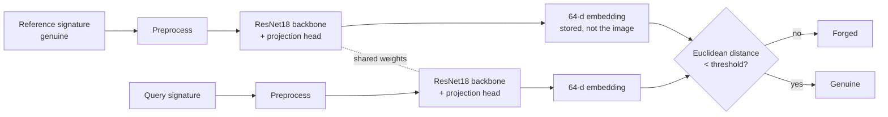

# One-Shot Siamese Signature Verification

Official code for the paper:

> **Optimizing Siamese Networks for One-Shot Signature Verification: Contrastive vs Triplet Loss**
> Carrissa Gloria Herman, Alexander Agung Santoso Gunawan, Jeffrey Junior Tedjasulaksana
> *2026 International Conference on Advancement in Data Science, E-learning and Information System (ICADEIS)*, Bandung, Indonesia, 23–24 June 2026 · IEEE
> [[Paper (IEEE Xplore)]](https://ieeexplore.ieee.org/document/11644504) · DOI: [10.1109/ICADEIS71120.2026.11644504](https://doi.org/10.1109/ICADEIS71120.2026.11644504)

> [!NOTE]
> The exact code used to produce the results in the paper is frozen at release **[`paper-v1`](https://github.com/carrissaherman/One-shot-Siamese-Signature-Verification/tree/paper-v1)**.
> The `main` branch may contain later improvements. See [Changes since publication](#changes-since-publication).

---

## TL;DR

**One reference signature + a Siamese ResNet18 trained with contrastive loss detects skilled forgeries with 96.04% accuracy on writers the model has never seen.** References are stored only as 64-d embeddings, never as images.

| Model | Accuracy | FAR (forgeries accepted) | FRR (genuine rejected) |
|---|:---:|:---:|:---:|
| **Contrastive loss** | **96.04%** | **4.58%** | **3.33%** |
| Triplet loss | 65.00% | 35.00% | 35.00% |

*CEDAR dataset · writer-independent test set (10 unseen writers, 480 pairs)*

**Conclusions**
- **Contrastive loss clearly beats triplet loss in this data-scarce, one-shot setting.** It converges faster and learns an embedding space where genuine and forged signatures barely overlap.
- **Triplet loss failed because of easy triplets.** Without hard-negative mining, most sampled triplets already satisfied the margin, giving near-zero loss and almost no gradient signal.
- **One-shot verification with embedding-only storage is viable.** It cuts both the data-collection burden and the biometric risk of storing raw signature images.
- **Caveat:** the decision threshold was chosen on the test writers, so the accuracy is optimistic. See [Limitations](#limitations).

Jump to: [Results](#results) · [Method](#method) · [Getting started](#getting-started) · [Limitations](#limitations) · [Citation](#citation)

---

## Overview

Offline signature verification systems usually need **many reference signatures per person** and store them as **raw images**, which is both hard to collect and a biometric security risk if the database leaks.

This project builds a **one-shot** verifier that:

- Needs **one genuine reference signature** per writer.
- Stores that reference only as a **64-dimensional L2-normalized embedding**, never as the raw image.
- Decides *genuine* vs *skilled forgery* by the Euclidean distance between embeddings.

It also compares two deep metric learning objectives, **contrastive loss** and **triplet loss**, in a data-scarce setting.

---

## Results

All results are on the **writer-independent test set** (10 writers never seen in training, 480 test pairs).

| Metric | Contrastive loss | Triplet loss |
|---|:---:|:---:|
| **Accuracy** | **96.04%** | 65.00% |
| Decision threshold (Euclidean) | 0.18 | 0.69 |
| False Acceptance Rate (FAR) | **4.58%** | 35.00% |
| False Rejection Rate (FRR) | **3.33%** | 35.00% |
| Mean genuine-pair distance | 0.0870 | 0.6793 |
| Mean forgery-pair distance | 1.0246 | 1.0109 |

**Confusion matrix, contrastive model** (positive = forged):

| | Predicted forged | Predicted genuine |
|---|:---:|:---:|
| **Actual forged** (240) | 229 (TP) | 11 (FN) → FAR 4.58% |
| **Actual genuine** (240) | 8 (FP) → FRR 3.33% | 232 (TN) |

The contrastive model's distance distributions for genuine and forged pairs barely overlap. Genuine pairs collapse to a tight cluster (mean distance ≈ 0.09), while forgeries are pushed near the margin (≈ 1.02). For the triplet model, the two distributions overlap heavily. Distance histograms and t-SNE plots of the embedding space are in the notebook and the paper.

> Note: the published abstract reports FAR as 4.48%. The correct value, from the confusion matrix (11 / 240), is **4.58%**, as stated in the paper's results table.

### Comparison with prior work (from the paper)

| Year | Work | Dataset | Approach | Shots | Accuracy |
|---|---|---|---|---|---|
| 2019 | Özyurt et al. | Private | Pretrained MobileNetV2 + ML classifiers | N/A | 97.70% |
| 2020 | Ruiz et al. | GAVAB | CNN + Siamese (BCE) | Few-shot | 95.16%* |
| 2022 | Liu et al. | Omniglot | CNN + Siamese (soft similarity) | One-shot | 95.72% |
| 2022 | Elaraby et al. | Chars74K | AlexNet + Siamese (contrastive) | Few-shot | 85.60% |
| 2026 | **Ours** | **CEDAR** | **ResNet18 + Siamese (contrastive)** | **One-shot** | **96.04%** |

\* Derived from the reported EER. Datasets and tasks differ, so this table gives context, not a head-to-head benchmark.

---

## Method



### Dataset and split

- **CEDAR** offline signature dataset: 55 writers, each with 24 genuine and 24 skilled-forgery signatures.
- **Writer-disjoint split:** writers 1–45 for training, writers 46–55 for testing (about 80/20).
  - This prevents *style leakage*: the model is always tested on handwriting it has never seen, which mirrors real deployment.
- `reorganize_data.ipynb` restructures the raw CEDAR folders (`full_org/`, `full_forg/`) into this layout:

```
train/
  writer_1/
    genuine/   original_1_*.png
    forged/    forgeries_1_*.png
  ...
  writer_45/
test/
  writer_46/ ... writer_55/
```

### Preprocessing

| Step | Train | Test |
|---|:---:|:---:|
| Pad to square with white (255), preserving aspect ratio | ✓ | ✓ |
| Random rotation ±10° (white fill) | ✓ | |
| Random affine: translate ≤ 10%, scale 0.9–1.1 | ✓ | |
| Color jitter: brightness 0.2, contrast 0.2 | ✓ | |
| Resize to 224 × 224 | ✓ | ✓ |
| Grayscale, replicated to 3 channels | ✓ | ✓ |
| Normalize with ImageNet mean and std | ✓ | ✓ |

The augmentations mimic real scanning variation: tilted signatures, off-center or zoomed scans, and lighting differences.

### Architecture

- **Backbone:** ResNet18 pretrained on ImageNet. A shallow backbone suits the simple visual structure of signatures and the small dataset.
- **Projection head:** replaces ResNet18's 1000-class classifier.
  ```
  Linear(512→256) → BatchNorm → ReLU → Dropout(0.5)
  Linear(256→128) → BatchNorm → ReLU
  Linear(128→64)
  ```
- **Output:** L2-normalized 64-d embedding, so all embeddings lie on the unit hypersphere.
- **Siamese setup:** a single embedding network with shared weights processes every image in a pair or triplet.

### Training objectives

**Contrastive loss (pairs).** Each sample is an anchor genuine signature from a random training writer, paired with either another genuine signature from the same writer (positive, *Y* = 0) or a skilled forgery of that writer (negative, *Y* = 1), each with 50% probability.

$$
L = (1-Y)\,D^2 + Y\,\max(0,\ m - D)^2
$$

**Triplet loss.** Each sample is an anchor (genuine), a positive (another genuine signature from the same writer), and a negative (a forgery of the same writer).

$$
L = \max(0,\ D(A,P) - D(A,N) + m)
$$

Here *D* is the Euclidean distance between embeddings and *m* is the margin.

### Hyperparameters

| Setting | Value |
|---|---|
| Epochs | 20 |
| Batch size | 32 |
| Optimizer | Adam, differential learning rates |
| LR, ResNet18 backbone | 1e-5 (avoids catastrophic forgetting) |
| LR, projection head | 1e-3 |
| LR schedule | StepLR, ×0.5 every 5 epochs |
| Margin *m* | 1.0 (both losses) |
| Training pairs per epoch | 2,160 |
| Test pairs | 480 (240 genuine, 240 forged) |
| Random seed | 88 |

### Verification at inference

1. Embed the writer's single reference signature once and store **only the 64-d vector**.
2. Embed the query signature.
3. If the distance is **below the threshold, predict genuine**; otherwise predict forged.

The notebook's `verify_signature(model, image_path, threshold, writer_id)` implements this.

---

## Repository structure

```
.
├── One-shot signature verification model.ipynb   # EDA, preprocessing, both models, training, evaluation, t-SNE, inference demo
├── reorganize_data.ipynb                          # Restructures raw CEDAR into the writer-disjoint train/test layout
└── README.md
```

---

## Getting started

### 1. Get the data
CEDAR is distributed for academic use by the Center of Excellence for Document Analysis and Recognition (CEDAR), University at Buffalo. A mirror is available on [Kaggle](https://www.kaggle.com/datasets/shreelakshmigp/cedardataset/data). The dataset is not included in this repository.

### 2. Organize it
Place `full_org/` and `full_forg/` next to `reorganize_data.ipynb` and run it. This produces `train/` and `test/`.

### 3. Train and evaluate
The main notebook was developed on **Google Colab with a GPU**. It expects `train.zip` and `test.zip` on Google Drive. Update `train_path` and `test_path` near the top of the notebook to point at your own copies, then run all cells.

Main dependencies: `torch`, `torchvision`, `scikit-learn`, `numpy`, `pandas`, `matplotlib`, `opencv-python`, `Pillow`.

---

## Limitations

- **Threshold selection.** The decision threshold was chosen by sweeping distances on the test writers. This makes the reported accuracy optimistic. An unbiased estimate needs the threshold selected on held-out *training* writers (a validation split) and applied once to the test set.
- **Small test set.** Only 10 test writers and 480 pairs. One misclassified pair changes accuracy by about 0.2 percentage points.
- **Random pair sampling.** Test pairs are sampled randomly, fixed by seed 88. Different seeds yield slightly different test sets and scores.
- **Single dataset.** Only CEDAR was used, with skilled forgeries only. Generalization to other scripts, scanners, or random forgeries is untested.
- **Writer ID required.** The writer must be specified at verification time; the model doesn't identify the writer itself.

## Future work

- Hard-negative or semi-hard mining for triplet loss
- Validation-based threshold selection, with EER reported alongside accuracy
- Cross-dataset evaluation (e.g. GPDS, BHSig260)
- Automatic writer identification before verification

---

## Changes since publication

| Version | Change |
|---|---|
| `paper-v1` | Code and results exactly as reported in the paper |
| `main` | README expanded; *(future: validation-based threshold, updated metrics)* |

---

## Citation

If you use this code, please cite:

```bibtex
@inproceedings{herman2026siamese,
  title     = {Optimizing Siamese Networks for One-Shot Signature Verification: Contrastive vs Triplet Loss},
  author    = {Herman, Carrissa Gloria and Gunawan, Alexander Agung Santoso and Tedjasulaksana, Jeffrey Junior},
  booktitle = {2026 International Conference on Advancement in Data Science, E-learning and Information System (ICADEIS)},
  address   = {Bandung, Indonesia},
  year      = {2026},
  publisher = {IEEE},
  doi       = {10.1109/ICADEIS71120.2026.11644504}
}
```

## Acknowledgments

- Supervised by Alexander Agung Santoso Gunawan and Jeffrey Junior Tedjasulaksana, Computer Science Department, Bina Nusantara University.
- CEDAR dataset: S. N. Srihari, S. Cha, H. Arora, and S. Lee, "Individuality of Handwriting," *Journal of Forensic Sciences*, vol. 47, 2002.

## License

Code released under the [MIT License](LICENSE). The CEDAR dataset is subject to its own academic-use terms.
